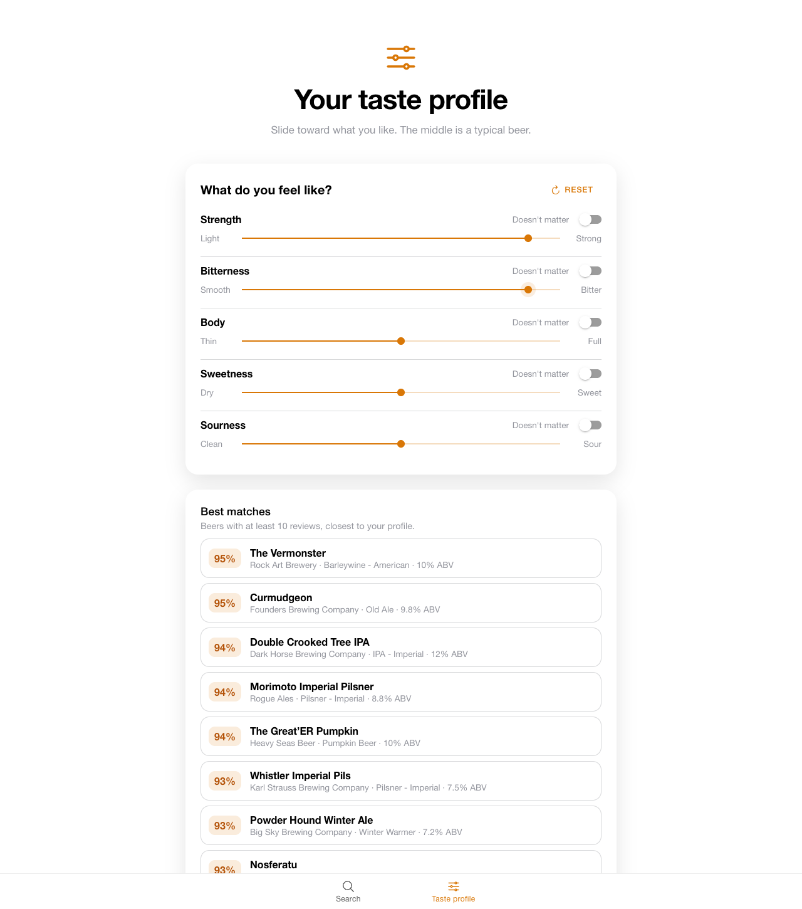

# Beer Recommender

Search for a beer you like and get recommendations for similar beers based on flavor profile, ABV and bitterness, or describe what you're in the mood for and see the beers that fit. The project has two parts: a Jupyter notebook for data exploration and recommender experiments, and an Ionic + React app that runs the recommenders in the browser.

**Live demo: https://martineza96.github.io/BeerRecommender/**

## Screenshots

| Search | Recommendations | Taste profile |
|---|---|---|
|  |  |  |

## Features

- **Forgiving search** across beer name, brewery and style. Partial words work ("blue mo"), accents are ignored ("munster" finds Münster), and common spellings match ("bud lite" finds Bud Light). The most-reviewed beers are listed first.
- **Beer details**: style, ABV, IBU range, rating and description.
- **Similar beers**: the 5 closest beers by cosine similarity on standardized ABV, IBU and 11 flavor-profile features. It's computed in the browser and gives the same results as the notebook.
- **Match by flavor or description**: a slider blends the flavor recommender with a description recommender (TF-IDF on each beer's description, exported from the notebook's method by `scripts/export_description_similarity.py`). Beers without a description fall back to flavor matches.
- **Taste profile**: five sliders (Strength, Bitterness, Body, Sweetness, Sourness) and the best-matching beers update as you drag. Sliders work in percentiles, so the middle is a typical beer; any feature can be set to "Doesn't matter".
- Popular-beer shortcuts, keyboard navigation, a Search / Taste profile tab bar, and light and dark themes.

## Data

The beer data comes from the *Beer Profile and Ratings Data Set* on Kaggle.

| File | Contents |
|---|---|
| `beer_profile_and_ratings.csv` | 3,197 beers: name, style, brewery, description, ABV, min/max IBU, 11 tasting-profile scores (astringency, body, alcohol, bitter, sweet, sour, salty, fruits, hoppy, spices, malty) and average review scores |
| `Beer Name Fuzzy Match List.csv`, `Brewery Name Fuzzy Match List.csv` | Name mappings used when matching beers and breweries across sources |
| `Beer Descriptors Simplified.xlsx` | Vocabulary of flavor descriptor words |
| `beerRecommenderApp/src/data/beersDF.json` | The dataset exported from the notebook for use in the app |
| `beerRecommenderApp/src/data/descriptionNeighbors.json` | Top 10 description (TF-IDF) neighbors per beer, generated by `scripts/export_description_similarity.py` |

## Project structure

```
BeerEDA.ipynb                        EDA, TF-IDF description recommender, feature recommender
scripts/export_description_similarity.py   Exports description neighbors for the app
requirements.txt                     Python libraries for the notebook and scripts
beerRecommenderApp/                  Ionic 7 + React 18 + Vite + TypeScript app
  src/data/beers.ts                  Typed, cleaned beer data
  src/utils/searchBeers.ts           Search and ranking
  src/utils/recommend.ts             Similar beers: flavor similarity, optionally blended with description
  src/utils/descriptionSimilarity.ts Description-neighbor lookup
  src/utils/tasteProfile.ts          Percentile matching for the Taste profile sliders
  src/components/BeerSearch          Search bar with dropdown results
  src/pages/Home.tsx                 Search page with beer details
  src/pages/TasteProfile.tsx         Taste profile page
.github/workflows/deploy.yml         Tests, builds and publishes the live demo to GitHub Pages
docs/screenshots/                    README images
```

## Getting started

### Run the app

Requires Node 18+.

```bash
git clone https://github.com/martineza96/BeerRecommender.git
cd BeerRecommender/beerRecommenderApp
npm install
npm run dev          # open the printed URL, usually http://localhost:5173
```

Other scripts: `npm run build` (type-check and production build), `npx vitest run` (unit tests).

### Run the notebook

```bash
python3 -m venv .venv
.venv/bin/pip install -r requirements.txt
.venv/bin/python -m nltk.downloader stopwords wordnet punkt punkt_tab
.venv/bin/jupyter notebook BeerEDA.ipynb
```

## Status

- [x] Dataset and exploratory data analysis
- [x] Description-based (TF-IDF) and feature-based recommenders in the notebook
- [x] App: search and beer details
- [x] App: similar-beer recommendations
- [x] Combine description similarity with feature similarity
- [x] Let users adjust recommendations (e.g. "less bitter", "lower ABV")
- [ ] User ratings and feedback
- [ ] Mobile build with Capacitor, and deployment

## Future goals

- Expand the dataset with more beers and reviews
- Collaborative filtering based on user preferences
- Personalized recommendations from user behavior
- Integration with external beer APIs
- Deploy as a web app or API
