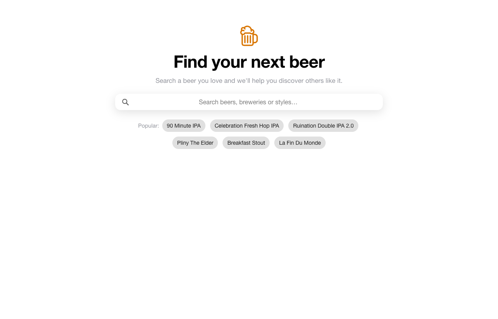
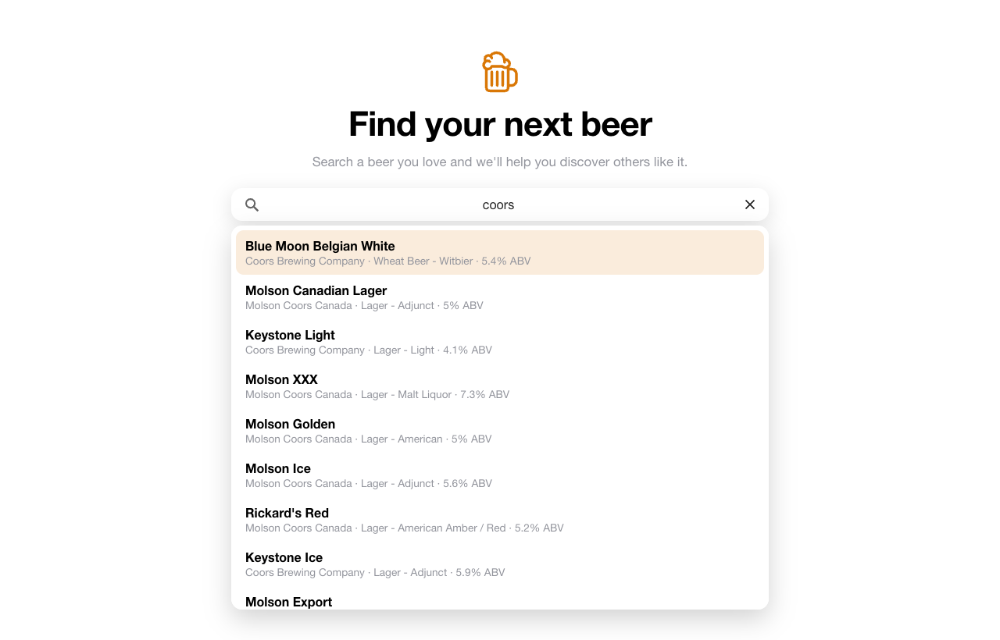
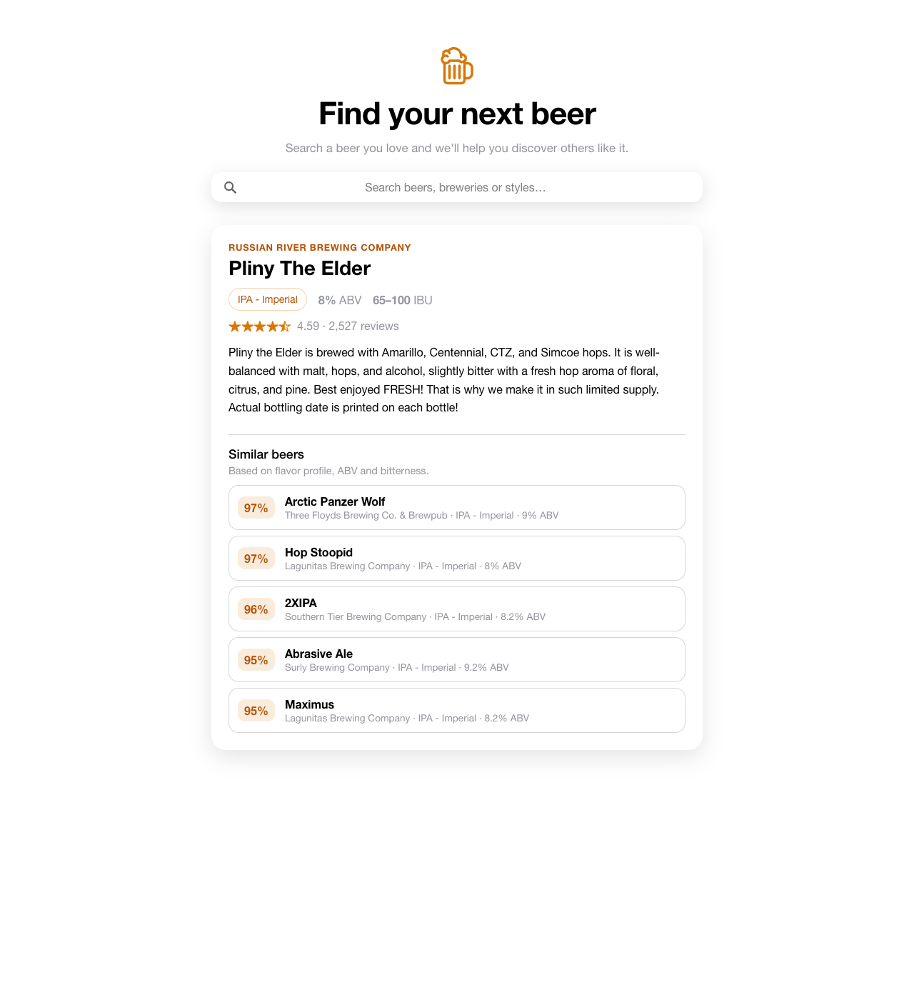

# Beer Recommender

Search for a beer you like and get recommendations for similar beers based on flavor profile, ABV and bitterness. The project has two parts: a Jupyter notebook for data exploration and recommender experiments, and an Ionic + React app that lets you search the beers and see recommendations.

## Screenshots

| Home | Search | Recommendations |
|---|---|---|
|  |  |  |

## Features

- **Forgiving search** across beer name, brewery and style. Partial words work ("blue mo"), accents are ignored ("munster" finds Münster), and common spellings match ("bud lite" finds Bud Light). The most-reviewed beers are listed first.
- **Beer details**: style, ABV, IBU range, rating and description.
- **Similar beers**: the 5 closest beers by cosine similarity on standardized ABV, IBU and 11 flavor-profile features. It's computed in the browser and gives the same results as the notebook.
- Popular-beer shortcuts, keyboard navigation, and light and dark themes.

## Data

| File | Contents |
|---|---|
| `beer_profile_and_ratings.csv` | 3,197 beers: name, style, brewery, description, ABV, min/max IBU, 11 tasting-profile scores (astringency, body, alcohol, bitter, sweet, sour, salty, fruits, hoppy, spices, malty) and average review scores |
| `Beer Name Fuzzy Match List.csv`, `Brewery Name Fuzzy Match List.csv` | Name mappings used when matching beers and breweries across sources |
| `Beer Descriptors Simplified.xlsx` | Vocabulary of flavor descriptor words |
| `beerRecommenderApp/src/data/beersDF.json` | The dataset exported from the notebook for use in the app |

## Project structure

```
BeerEDA.ipynb                 EDA, TF-IDF description recommender, feature recommender
beerRecommenderApp/           Ionic 7 + React 18 + Vite + TypeScript app
  src/data/beers.ts           Typed, cleaned beer data
  src/utils/searchBeers.ts    Search and ranking
  src/utils/recommend.ts      Feature-based similar-beer recommendations
  src/components/BeerSearch   Search bar with dropdown results
  src/pages/Home.tsx          Home page
docs/screenshots/             README images
```

## Getting started

### Run the app

Requires Node 18+.

```bash
git clone https://github.com/martineza96/BeerRecommender.git
cd BeerRecommender/beerRecommenderApp
npm install
npm run dev          # open the printed URL, usually http://localhost:5173
```

Other scripts: `npm run build` (type-check and production build), `npx vitest run` (unit tests).

### Run the notebook

```bash
pip install pandas numpy matplotlib scikit-learn nltk jupyter
jupyter notebook BeerEDA.ipynb
```

## Status

- [x] Dataset and exploratory data analysis
- [x] Description-based (TF-IDF) and feature-based recommenders in the notebook
- [x] App: search and beer details
- [x] App: similar-beer recommendations
- [ ] Combine description similarity with feature similarity
- [ ] Let users adjust recommendations (e.g. "less bitter", "lower ABV")
- [ ] User ratings and feedback
- [ ] Mobile build with Capacitor, and deployment

## Future goals

- Expand the dataset with more beers and reviews
- Collaborative filtering based on user preferences
- Personalized recommendations from user behavior
- Integration with external beer APIs
- Deploy as a web app or API
